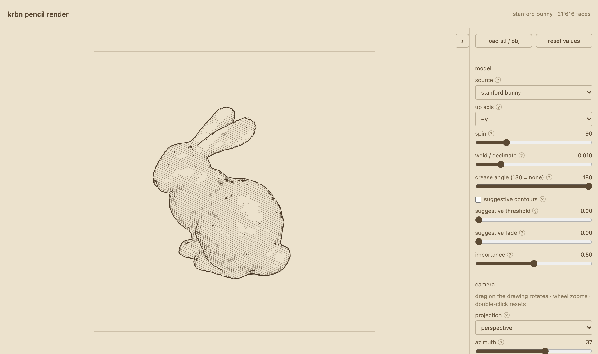

# krbn pencil render

A web app for [Krbn](https://github.com/vpalos/Krbn), Valeriu Paloș's engine for pencil-style line drawings. The app is a single HTML file: load an STL or OBJ model, adjust lines, hatching and camera, and save the result as SVG or as a raster image. The SVG output can go straight to a pen plotter.



## Usage

Open `index.html` in a browser, by double-click or as `file://`. No server is needed; the engine and the demo model are embedded in the file.

There are eight demo models: the Stanford bunny, a bevel gear from the Apollo 11 crew hatch, the bitcoin sign ₿ and five shapes that Krbn generates itself. Choosing a demo also sets suitable values for up axis, spin, crease angle and hatching. Load your own model with «load stl / obj» or by dropping the file onto the drawing area. Rendering runs in a web worker, so the interface stays responsive with large models.

Drag on the drawing to rotate the camera, use the mouse wheel to zoom, double-click to reset the camera. The panel exposes every setting of the engine:

- model: up axis, spin, decimation, crease angle, suggestive contours
- camera and light: projection, angles, zoom, image size
- lines and hatching: color, weight, wobble, hidden lines, hatch mode, angle, spacing
- output: background, plotter centerlines, paper sizes from A0 to Half Letter, raster export as PNG or WebP

With a paper size selected, the drawing is placed on the page with a 10 mm margin, and the stroke width is 0.3 mm per unit of line weight. Transparent background and plotter centerlines are on by default. For a raster image with swelling pencil strokes, switch centerlines off and «variable width» on.

## Models

| Model | Source | License |
|---|---|---|
| Stanford bunny | [Stanford 3D Scanning Repository](https://graphics.stanford.edu/data/3Dscanrep/), Stanford Computer Graphics Laboratory; OBJ from [common-3d-test-models](https://github.com/alecjacobson/common-3d-test-models) | free redistribution, no commercial use without permission |
| Apollo 11 bevel gear | [External Input Bevel Gear](https://commons.wikimedia.org/wiki/File:External_Input_Bevel_Gear_v27_(Hatch,_Crew,_Apollo_11_by_NASA_and_Smithsonian_Institution).stl), crew hatch of Apollo 11, NASA and Smithsonian Institution | CC0 |
| bitcoin sign ₿ | [U+20BF Noto Sans](https://commons.wikimedia.org/wiki/File:U%2B20BF_Noto_Sans_20230523.stl), 3D model by PantheraLeo1359531, glyph from the Noto Sans font by Google | CC0 |

Because of the Stanford terms, `index.html` as a whole may not be used commercially without Stanford's permission. The code itself is MIT.

More test models to try with the upload, from [common-3d-test-models](https://github.com/alecjacobson/common-3d-test-models) (the repository states no licenses):

- [fandisk.obj](https://raw.githubusercontent.com/alecjacobson/common-3d-test-models/master/data/fandisk.obj), a CAD part
- [rocker-arm.obj](https://raw.githubusercontent.com/alecjacobson/common-3d-test-models/master/data/rocker-arm.obj), a machine part
- [teapot.obj](https://raw.githubusercontent.com/alecjacobson/common-3d-test-models/master/data/teapot.obj), the Utah teapot
- [spot.obj](https://raw.githubusercontent.com/alecjacobson/common-3d-test-models/master/data/spot.obj), Keenan Crane's cow

## Building

`app.html` is the template without the engine and only shows a notice when opened. The working `index.html` is built with:

```
./build.sh
```

On the first run the script clones Krbn into `Krbn/`, bundles `worker.ts` with esbuild and inserts the result into the template. The Krbn commit the build came from is written into a comment at the top of `index.html`. To update the engine:

```
git -C Krbn pull && ./build.sh
```

Requires Git and Node.js; `npx` fetches esbuild during the build.

## Files

| File | Content |
|---|---|
| `index.html` | the built app |
| `app.html` | interface, template for the build |
| `worker.ts` | builds the scene and calls Krbn |
| `build.sh` | build script |
| `models/` | embedded demo models |

## License

The code is MIT, see [LICENSE](LICENSE). `index.html` contains Krbn, which is MIT-licensed as well (Copyright 2026 Krbn contributors); its license text is at the top of `app.html` and `index.html`. The embedded models have their own terms, see [Models](#models).
